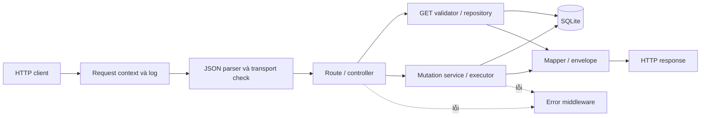
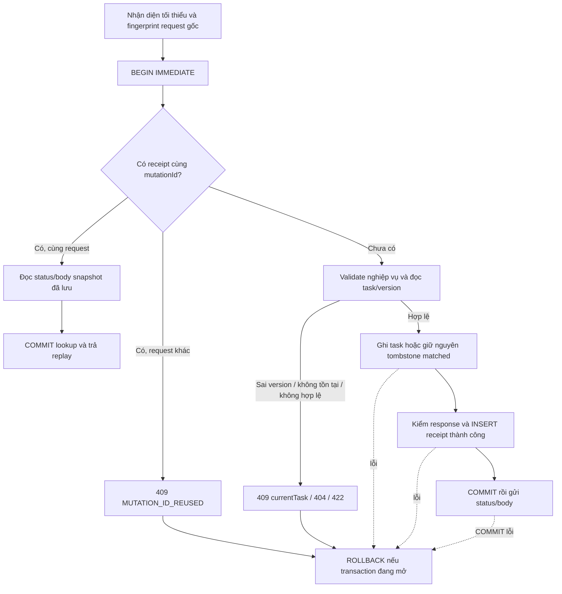

# Kiến trúc hệ thống

## Phạm vi đã triển khai

Backend là một process Node.js/Express 5, SQLite file qua better-sqlite3, JavaScript ES modules. `src/server.js` mở connection/schema đã migrate rồi listen; `src/app.js` ghép app và cho phép test cấp connection riêng. Không tự migrate/seed lúc start. Không có tài khoản, realtime hoặc endpoint test/reset trong HTTP production.

| Lớp / file dưới `server/src/` | Trách nhiệm thực tế |
|---|---|
| `routes/read-routes.js`, `write-routes.js` | Sáu endpoint; GET gắn validator, ghi chỉ kiểm tra transport trước executor |
| `controllers/task-controller.js`, `health-controller.js` | Chuyển request vào service/repository; gửi status/body sau executor trả về; health rỗng 200/503 |
| `services/task-mutation-service.js` | POST/PUT/DELETE: tồn tại, version, server timestamp, tombstone/no-op; dùng executor chung |
| `mutations/mutation-executor.js`, `request-fingerprint.js` | Fingerprint, lookup receipt trước full validation/version; transaction, snapshot response và replay |
| `repositories/*` | SQL binding trên connection được cấp; không tự mở transaction/connection ghi thứ hai |
| `validation/task-fields.js`, `task-requests.js` | Kiểu JSON, giới hạn nghiệp vụ, UUID, ngày, query/header; không ép kiểu dữ liệu nghiệp vụ |
| `http/task-responses.js` | Snake_case → camelCase, INTEGER → boolean; kiểm response/receipt không chứa trạng thái nội bộ |
| `middleware/error-handler.js`, `http/api-errors.js` | 404/409/422 và lỗi transport; lỗi hạ tầng trả 500 kín, không giả conflict |
| `logging/request-log.js`, `middleware/request-log.js` | Metadata an toàn, requestId/mutationId, kết quả sau commit; log không thay receipt |

## Mutation, retry và rollback

Receipt được kiểm tra trước version để retry sau mất response vẫn nhận đúng kết quả cũ, dù task đã đổi tiếp. Fingerprint SHA-256 từ method/path/query/body JSON gốc canonicalize; key object không ảnh hưởng, đổi kiểu/nội dung/baseVersion là request khác. Không đưa mutation ID/thời gian vào hash. Parser/nhận diện tối thiểu vẫn có thể từ chối request trước transaction; không phải mọi lỗi đều đi qua lookup receipt.

Task và receipt thành công dùng cùng transaction IMMEDIATE/cùng connection: hoặc cả hai commit, hoặc rollback; DELETE no-op chỉ ghi receipt trong transaction đó. Service callback đồng bộ, không chờ mạng hoặc tự COMMIT. Replay không chạy callback. Response chỉ gửi sau commit, nên mất response không thể được hiểu là thất bại ghi. SQLITE_BUSY là lỗi tạm thời 5xx; client giữ nguyên snapshot khi retry. [Database](database-design.md) giải thích schema, canonicalization và giới hạn callback.

Version do server tăng, không dùng giờ thiết bị để chọn bên thắng. 409 trả currentTask đầy đủ để client giữ hai snapshot và hỏi người dùng chọn toàn bộ phiên bản. Backend không có UI hoặc endpoint tự giải quyết xung đột. Lựa chọn giữ bản thiết bị là mutation mới dùng version mới nhất; server có thể tiếp tục đổi và lại 409.

## Ranh giới Android và kiểm chứng

Room/UI/outbox/SyncEngine có mã phía Android nhưng audit Bước 11 chưa có đường HTTP thật từ app; không vẽ mũi tên Android → server như thành phần đã chạy. Binding mạng, scheduler/worker, resolver và hai thiết bị còn do A/cả nhóm xác nhận theo [setup](setup.md). Fake chỉ dùng debug/test.

Integration backend dùng router/controller/service/executor/SQLite thật; restart dùng hai process tuần tự để kiểm persistence. Concurrency dùng hai Worker/connection tranh khóa thật rồi retry, không phải hai lệnh nối tiếp được gọi là đồng thời. [Kết quả](testing/test-results.md) phân biệt các mức này với stress, mất điện, Android và benchmark chưa chạy. Nguồn kỹ thuật: [tham khảo](references.md).
